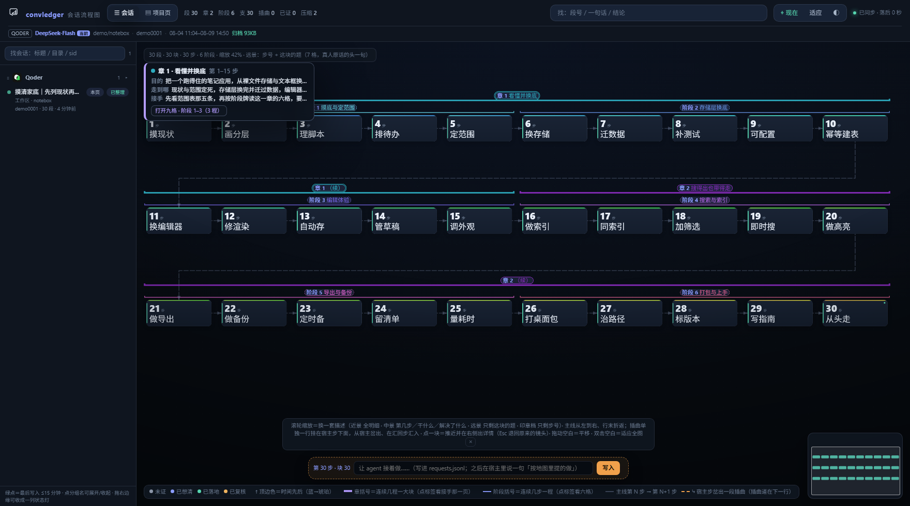
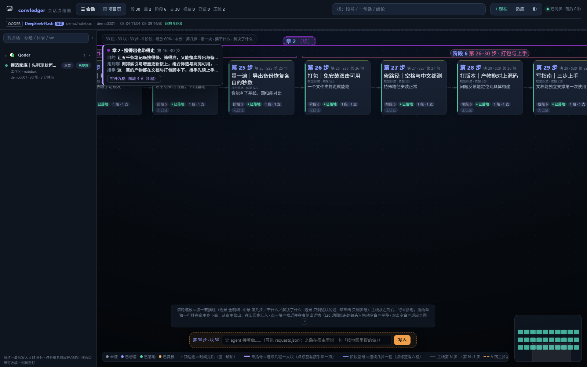
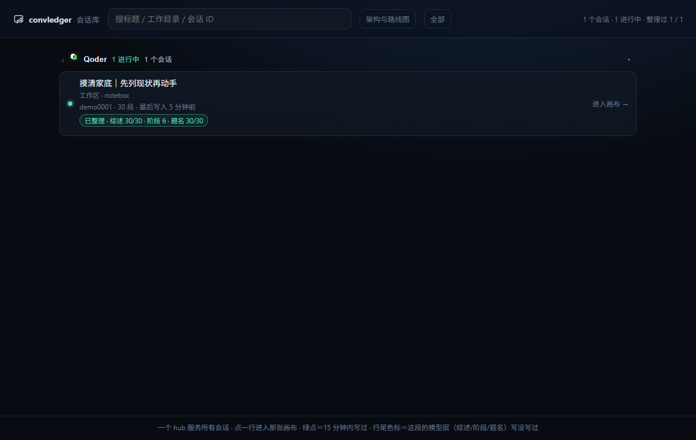
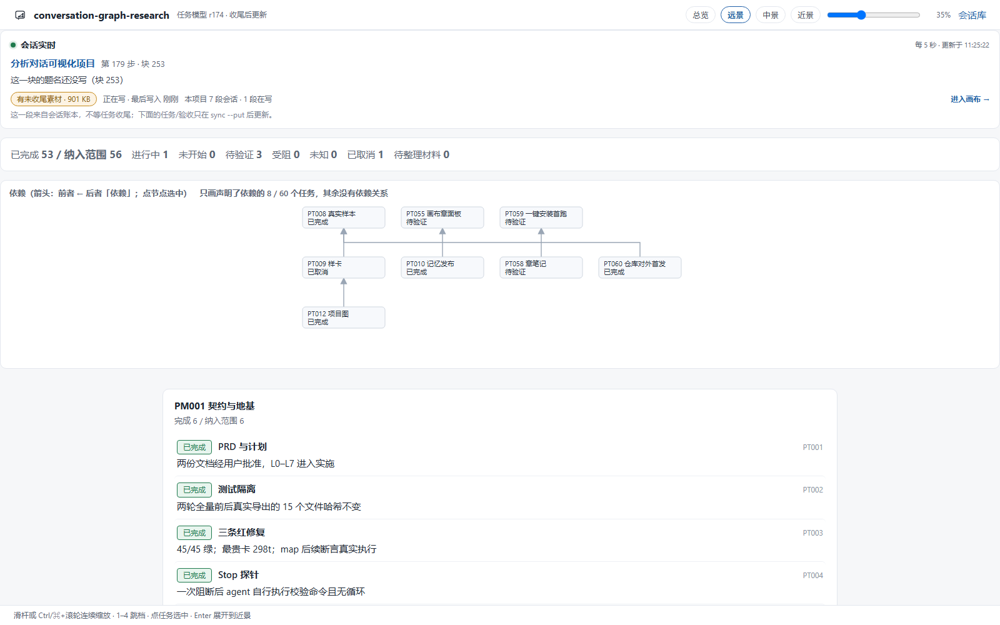
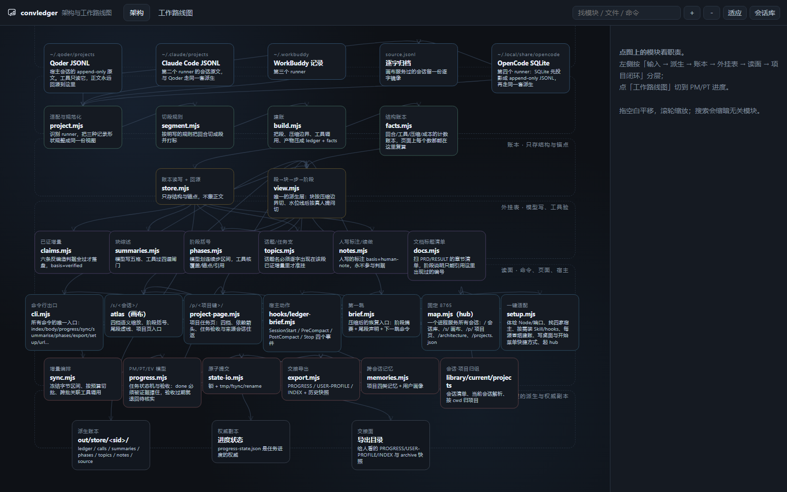
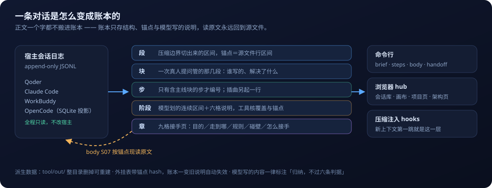

<div align="center">


# convledger

### 把 Agent 的聊天记录，变成一本**查得到、回得去、接得上**的账

零运行时依赖 · 只用 Node 内置模块 · 全程只读宿主日志 · 数据只在你本机

[](#为什么它不糊弄你)
[](#五分钟跑起来)
[](https://github.com/zhl110/convledger/releases)
[](#页面长这样)



<sub>画布全图（远景）。这张图跑的是**合成演示账本**——界面是真的，数据是编的。</sub>

</div>

---

## 你是不是也踩过这三件事

| 没有它 | 有它 |
| --- | --- |
| 上下文一压缩，前面几十程被尾部截掉，新会话里 agent 只会说「我们之前做了什么」——说得像，但对不上 | 压缩边界自动注入**章层**：一开始的目的、走到哪、碰过的壁、怎么接手，一次给全，且每格都能回源核对 |
| 想查「那次改存储的结论是什么」，只能翻聊天记录，或者让模型重读整段会话（实测 226 段全读约 560 万 token） | `convledger body S07` 按锚点现读那一段；一次恢复记忆的第一跳 `brief` 只要 **1,200 token 左右** |
| 界面越做越多，进度只存在某个人的记忆里，别人接手要先问一遍 | 一个 hub 固定 `http://127.0.0.1:8765`：会话库、每段会话的画布、项目任务页、架构页都在里面，任务状态有验收闸门 |

## 页面长这样

<table>
<tr>
<td width="50%"></td>
<td width="50%"></td>
</tr>
<tr>
<td><b>中景</b>——滚轮缩放换的是<b>一套描述</b>，不是字号：近景全明细、中景一行干什么、远景只剩步号。每张卡都写着「模型综述 · 依据 Sxx」。</td>
<td><b>会话库</b>——一个 hub 服务本机所有会话，绿点＝15 分钟内写过，行尾色标直接告诉你这段整理过没有。</td>
</tr>
<tr>
<td></td>
<td></td>
</tr>
<tr>
<td><b>项目任务页</b>——按工作目录归项目，四档查看阶段与任务、依赖箭头、验收证据；顶部还有**经验（按阶段收拢）与用户画像**，每 5 秒随账本刷新。这张就是<b>本仓自己的任务表</b>。</td>
<td><b>架构页</b>——七层模块图与 PM/PT 路线图，可点、可搜、可缩放；工具把自己的实现摊开给人看。</td>
</tr>
</table>

## 一条对话是怎么变成账本的



| 层 | 是什么 | 谁写的 |
| --- | --- | --- |
| **段** | 压缩边界切出的区间，锚点＝源文件行区间 | 规则 |
| **块** | 一次真人提问管的那几段 | 规则 |
| **步** | 只有含主线块的步才编号，插曲另起一行 | 规则 |
| **阶段** | 连续几步算一程，配六格说明 | 模型写 · 工具验 |
| **章** | 几十程并成「一大块」，九格接手页 | 模型写 · 工具验 |

**正文一个字都不搬进账本。** 段、块、步、阶段、章都只是索引；要读原文就 `body S07`，锚点解引用回源 JSONL。源日志被宿主清掉了，会回落到画布服务过的那份逐字归档，并明确声明「读自归档，不是新的真相」。

## 五分钟跑起来

```bash
# 1) 装 Node ≥20（接 OpenCode 要 22.5，低于它只是那一家来源跳过）
# 2) 克隆仓库
git clone git@github.com:zhl110/convledger.git
cd convledger

# 3) 装起来
#    Windows：双击 install.cmd（或跑下面这条）
#    Linux：跑下面这条，会装 Skill/hooks、建账、写一个应用菜单入口，再起 hub
#    macOS：跑下面这条（尚未在真机实测；见「如实的边界」）
node tool/bin/convledger.mjs setup
```

`setup` 一条命令做完：体检 Node、账本目录与 8765 端口 → 找本机装了哪几家宿主（**只数这台机器上真有源的**）→ 按需装 Skill 与 hooks → **按写入时间建最近 20 个会话的账** → 建桌面与开始菜单快捷方式 → 起 hub 并打开会话库。结尾固定四行「下一步」，包括**还缺什么**（没建账的个数、没接的来源），不写「一切就绪」。

装完想先看看它长什么样，不用拿自己的会话试：

```bash
node tool/bin/convledger.mjs sessions --all      # 本机有哪些会话、建账了没有
node tool/bin/convledger.mjs map                 # 起 hub，打印本会话画布地址
node tool/bin/convledger.mjs outstanding         # 链路欠项自检
node tool/hooks/install.mjs --client all         # 单独重挂压缩边界注入（Qoder / WorkBuddy / OpenCode）
```

关掉浏览器页面不会停 hub。要回来：双击桌面或开始菜单里的「convledger 地图」，或跑 `convledger url --copy`（确保 hub 在跑并把地址放进剪贴板）。地址是固定的 `http://127.0.0.1:8765/`，存个书签就行。

在 Agent 里让它自己开页面：`map` / `setup` 别加 `--open`（那只开系统浏览器），拿到打印的地址后由 agent 用宿主的浏览器面板打开。

画布顶栏的**「补账」**可切三档：**每轮 / 每 5 轮 / 压缩时**。档位决定 Stop hook 什么时候把「已收口但缺综述的块」交给当前会话的 agent——用的就是它正在跑的模型，不需要另配密钥；一块只补一次，画布几秒后自己换上新标题。

项目页顶部的**「经验 · 按阶段」**把块综述里的 lesson 按会话与阶段收拢，**「用户画像 · 做事方式」**读两张记忆表的条目，0 条就如实写 0 条。`convledger export` 会把经验写进 `PROGRESS.md`，并在 `convledger-export/sessions/<会话>-notes.md` 生成可直接拿走的会话笔记（章、阶段、经验、回读命令）。

## 给 Agent 用的时候

新上下文进来，第一跳不用人提醒就有东西读——压缩边界由 hooks 注入这一层：

```text
[convledger · 工具派生，不是模型记忆] 会话启动自动续上：
账本 demo0001 · 596 段 / 253 块 / 179 步 · 阶段 35 段覆盖第 1–176 步 · 章 6 段覆盖第 1–176 步
章 6 · 第 168–176 步 · 块 240–250 · 读得出也装得上
  目的：把前面每一层交给人读、交给新机器装：读的一方不点也能看懂一大块，装的一方一条命令就用得上。
查法：handoff（接手一页）· brief --chapter n（九格）· steps（全块）· body Sxx（逐字原文）
```

一整块（章）的接手页长这样——`convledger handoff` 的真实输出，数据取自上面那张演示账本：

```text
章 2 · 第 16–30 步 · 块 16–30 · 阶段 4–6 · 搜得出也带得走
basis=model（归纳，不过六条判据） · 写于 2026-11-03 03:30
一开始的目的：让五千条笔记既搜得快、筛得准，又能整库导出与备份，最后打成别人双击就能用的包
走到哪：倒排索引与增量更新接上，组合筛选与高亮可用，导出备份恢复定时四条路跑通，免安装包在干净目录走过一遍
核心规则与原则：两处要显示同一件事就共用一份函数；性能要有基线才谈回归；首跑要在隔离环境从头走
碰过的壁：慢响应会盖住新结果，需按序号丢弃；安装路径含空格与中文时启动脚本没加引号直接起不来
怎么接手：这一章的产物都在文档与打包脚本下，接手先读上手指南，再从块表找对应块回读原文
```

块表是给人和 agent 共用的同一份编号——`convledger steps` 一次调用拿到全部块，每行自带回读命令：

```text
块 30 · 主线步 30 · 插曲支 0 条 · 已证增量 0/30 段（其余块只有结构，没有过判据的话可说）
  6   步6 主线     S06         第 6 句     支1 写2 | 换存储｜JSON 文件改数据库 ⇒ 写入不再整档重写，崩溃不留半截文件 | convledger body S06
  7   步7 主线     S07         第 7 句     支1 写1 | 迁数据｜迁老数据｜逐条核对条数 ⇒ 迁移可重放，核对报告可复查 | convledger body S07
```

## 为什么它不糊弄你

- **工具一次模型都不调。** 综述、阶段、章、记忆都是「模型写、工具验」的外挂表，写入口各有闸门：块综述四道、阶段八类、认识增量六条反编造判据、记忆 G0–G9。闸门不过就整批不写，**不改判据迁就文字**。
- **锚点带 hash，账本一变旧说明自动失效**，回落成结构事实，绝不把旧的概括挂到新的内容上。
- **模型写的一律标注**：页面上写着「模型综述／模型说明（归纳，不过六条判据）」，`basis=model` 永远不等于 `verified`。
- **标题不许截原话**：卡片题名优先用综述；没有综述只许写「写 xx 等 n 件」这类派生标题并标注，不拿半句用户原话顶替。
- **派生数据可整目录重建**，对源日志全程只读；`tool/out/` 删掉，账本从源文件重新长出来。
- **hook 是只读推送层**：拿不到账本就一个字都不注（fail-open），也不许在 hook 里现写阶段或综述——那等于绕过闸门往上下文里塞话。

## 命令一览

`[--session 会话前8位] [--store 账本根]` 所有命令通用。下面是最常用的那几条，全部命令见 `convledger help`。

| 想做的事 | 命令 |
| --- | --- |
| 新设备一键装 / 撤干净 | `setup` · `setup --uninstall` · `setup --check` |
| 知道自己在哪 | `brief` · `brief --chapter n` · `handoff` |
| 逐程检索 | `steps` · `show` · `card S07` · `body S07-S11` |
| 写外挂表（模型写、工具验） | `digest --block N` → `summarise --put` · `phases --put` · `chapters --put` · `claim` |
| 链路自检与经验出口 | `outstanding` · `lessons` · `rules` · `requests --pending` |
| 跨会话记忆与交接 | `memory` · `memory --digest` · `export` · `export --check` |
| 项目任务闭环 | `progress --project <键>` · `sync --prepare` → `sync --put` |
| 把页面拉起来 | `map` · `url --copy` · `map --stop` |

## 如实的边界

- **Windows 有桌面/开始菜单快捷方式；Linux 写应用菜单入口（`~/.local/share/applications/convledger.desktop`）**，setup 体检、建账、brief 与 hub 已在 WSL Ubuntu 跑通（应用菜单本身没在真桌面点过）；**macOS 暂未实测**，用 `bash open-map.sh` 或 `convledger url --copy` 回到页面。
- 「干净机器上双击 `install.cmd`」这条路径在开发机上没法验（会动真桌面），只在隔离的临时用户目录里从头走过装与撤。
- OpenCode 插件的**实机事件投递**还没在真实回合上观察到；它的投影是缓存，锚点指向投影字节而非宿主原始行。
- 块综述、阶段与章说明**必须由模型在会话里补**，工具不代写；`outstanding` 是链路欠项的唯一出口，缺的就摆在报告里。
- 上面那两张画布图来自**合成演示账本**；本机的真实界面长同样的结构，但内容是你自己的。

## 版本、升级与卸载

- **版本看 tag 与 CHANGELOG**：`v0.1.0` 是第一个对外发布的版本，发布记录在 [Releases](https://github.com/zhl110/convledger/releases)，行为级变更逐条在 [CHANGELOG.md](CHANGELOG.md)。
- **升级**：`git pull --ff-only` 后重跑一次 `setup`——它会重装 Skill 正本（路径按新位置渲染）、补挂 hooks、给还没建账的会话建账。改了 `tool/web/` 或 `src/` 要重启 hub（`map --stop` 再 `map`），**已经开着的页面刷新一次**。
- **卸载**：`setup --uninstall` 只撤自己写过的东西——Skill 文件、`settings.json.hooks` 里自己的四个条目（别人的 hook 与配置键原样保留）、那两个快捷方式。账本与导出是派生数据，命令只打印路径，删不删由你决定。

## 目录与工程侧

```
tool/
  bin/convledger.mjs        唯一入口（命令分发全在 src/cli.mjs）
  src/                      账本与派生：project/segment/build/facts/store/view
                            外挂表：claims/summaries/phases/chapters/topics/notes
                            读面：brief/map/project-page/library/current/projects
                            项目闭环：progress/state-io/sync/export/memories
  web/                      hub、atlas（画布）、architecture（架构页）
  hooks/                    ledger-brief.mjs（Qoder/WorkBuddy）、opencode.mjs + 插件、install.mjs
  skill/                    convledger 正本与 install.mjs（同步到各宿主用户级目录）
  out/                      派生数据：store/<会话>/、projects/<键>/（可整目录重建，不入库）
docs/img/                   README 用的图
```

- 提交前密钥扫描：`node tool/scan-secrets.mjs`（gitleaks 扫历史与暂存区；`--staged` 只扫暂存）。
- 自测：`node tool/test/selftest.mjs`（66 条，含 OpenCode 投影、setup 宿主检测与隔离 HOME 端到端装/撤、Skill 与命令面漂移守卫）。
- 几条不能破的纪律：**正文不搬进账本**、**闸门不过就不写**、**没验过的不说通过**、**hook 只读**。细则见仓库根 `RULES.md`。

## 免责声明

- **代码可见/可用不等于作者兜底**：本项目仅供学习与自用，使用者自行承担使用风险。
- 本工具会读取本机会话日志、在本机起一个只监听 `127.0.0.1` 的服务，并可选地注册 hooks（会执行命令行）。请只在本机使用，不要暴露到公网，也不要把不信任的数据喂给它。
- **赞赏属于自愿捐赠**：不承诺 bug 修复、技术支持或售后。
- **不得用于任何违规用途**：使用者对自己的行为负责；因使用本项目引起的任何责任由使用者承担。

## 许可

源码可见：**免费使用全部功能、允许二创、允许非商业分享；不可以售卖或收费分发**；二创必须把改动提交回本仓，未回传的修改版不许分享。完整条款见 [LICENSE.md](LICENSE.md)——注意这不是 OSI 开源许可。

## 数据与隐私

会话原文、按锚点派生的账本、项目导出与会话笔记都只留在使用者本机：`tool/out/` 与 `convledger-export/` 刻意不入库，删掉也能从源日志重建。仓库里只有代码、文档与合成演示图；演示图不包含任何真人会话内容。

## 如果它帮到了你

这个工具免费、零依赖，也不会为了功能向你要钱。
如果它确实替你省了时间，可以自愿请我喝杯咖啡——**这是个人打赏，不是购买服务**：不影响功能、排期与支持，也不开具发票。

<p align="center">
  
  &nbsp;&nbsp;&nbsp;&nbsp;
  
</p>

<p align="center"><sub>微信 · 支付宝</sub></p>

<sub>扫码即表示你了解：这是个人赞赏，不是商品或服务交易。感谢支持。</sub>
